

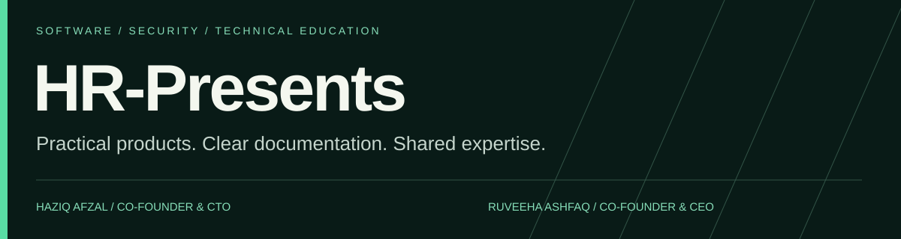

**Haziq Afzal & Ruveeha Ashfaq · Co-founders & Udemy instructors**

Software products · Cybersecurity · Linux & DevOps · Automation · Education

 &nbsp;  &nbsp;  &nbsp;  &nbsp;  &nbsp;  &nbsp;  &nbsp;  &nbsp; 

HR-Presents is our independent technology collaboration, founded in 2026. We build practical software, document engineering workflows and teach the skills behind them. Both founders contribute across planning, development, testing, documentation and delivery.

**Choose your next step**

## 

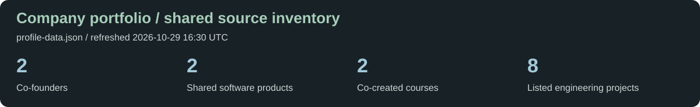

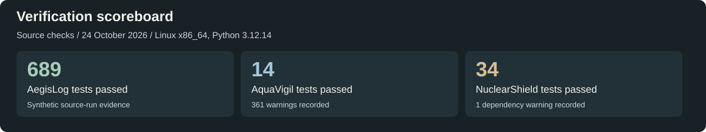

These are dated tests of specific source commits using synthetic inputs. Counts reflect different test suites; they are not comparable product scores or detection-accuracy ratings.

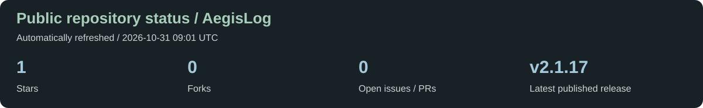

### 

<a href="https://github.com/HR-Presents">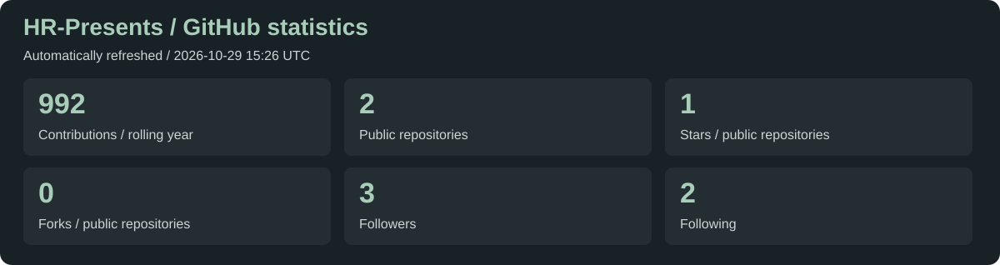</a>

Public HR-Presents account statistics refresh automatically every six hours and on profile-source edits. The cards show their last successful refresh time. Language shares aggregate bytes across public, non-fork repositories; private source is excluded.

<!-- LIVE-WORKFLOW:START -->
**Latest release workflow:** failure · checked 2026-10-29 15:26 UTC. Published-release availability is separate from a newer workflow result.

<!-- LIVE-WORKFLOW:END -->

---

## 

<a href="https://github.com/HaziqBinAfzal/HaziqBinAfzal/blob/main/docs/case-studies/sentrix.md">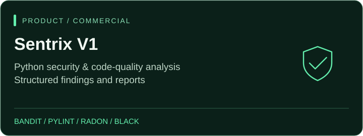</a> <a href="https://github.com/HR-Presents/AegisLog">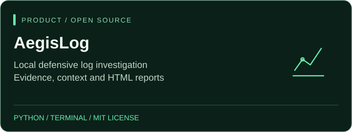</a>

**Sentrix V1 · Code review workspace**  
Brings Bandit, Pylint, Radon, Black and syntax validation into a local browser workspace, with structured findings, history and downloadable reports. Commercial software; private source.  
 &nbsp;  &nbsp; 

**AegisLog · Evidence investigation**  
Investigates supported log files and accessible Windows, Linux and Docker telemetry. It provides explained findings, incident context and local evidence reports. Free, open source and MIT licensed.  
 &nbsp;  &nbsp;  &nbsp; 

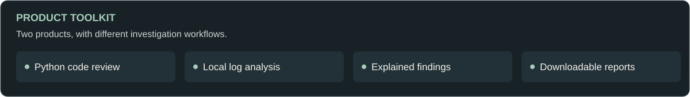

---

## 

<a href="https://github.com/HaziqBinAfzal/AquaVigil">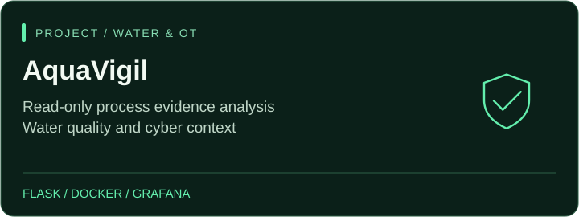</a> <a href="https://github.com/ruveeha33/NuclearShield">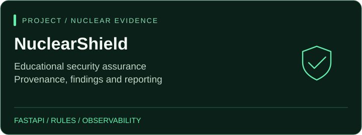</a>

**AquaVigil · Water & OT evidence**  
 educational water and desalination evidence analysis with Flask, Docker, SHA-256 provenance and observability. Haziq is the project author; Ruveeha contributes.  
 &nbsp; 

**NuclearShield · Security evidence**  
 Ruveeha’s educational project for security evidence, provenance, rules, statistical screening and reporting.  
 &nbsp; 

<a href="https://github.com/HaziqBinAfzal/linux-backup-recovery-system">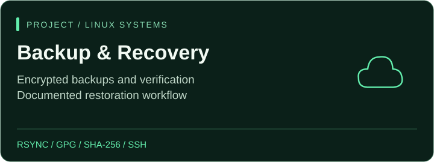</a> <a href="https://github.com/ruveeha33/AI-Log-Analyzer">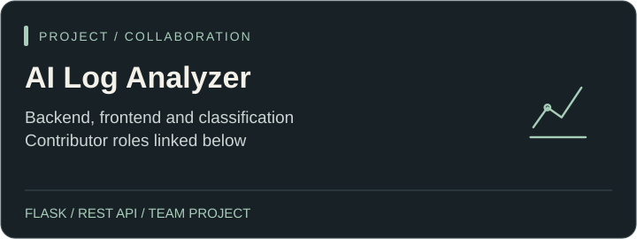</a>

**Linux Backup & Recovery · Systems workflow**  
 rsync, tar, GPG, SHA-256, SSH, cron and restoration evidence. Built by Haziq, Ruveeha, Ambreen Imtiaz and Muhammad Buddha.  

**AI Log Analyzer · Collaborative development**  
 Ruveeha: Flask backend/API; Haziq: frontend/API integration; Ambreen Imtiaz: classification logic.  

**Continue exploring**  
  &nbsp;  &nbsp;  &nbsp; 

LinuxOps Phase 01 is documented; later phases remain planned. SFVDS credits Haziq, Ruveeha and Ambreen. Jira automation is joint work by both founders. AquaVigil and NuclearShield analyze educational evidence and do not control industrial facilities.

---

## 

Our tools span product implementation, labs and study; experience varies by project. Other areas include Azure, REST APIs, SSH, GPG, machine learning, NLP and data analysis. 

---

## 

<a href="https://www.udemy.com/course/docker-mastery-from-beginner-to-job-ready/">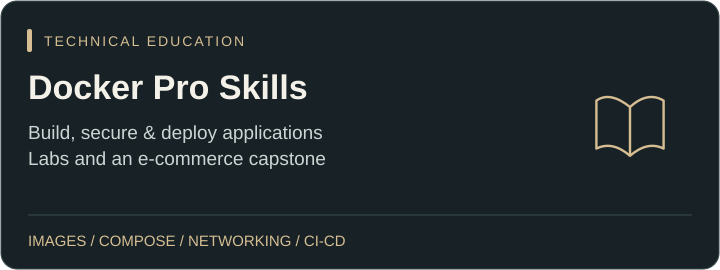</a> 

**Docker Pro Skills: Build, Secure & Deploy Applications**  
 images, Dockerfiles, Compose, networking, storage, security and CI/CD, with practical labs and an e-commerce capstone.  

**Think Before You Click: The Online Safety Course**  
 scams, phishing, account protection, privacy and AI deception through missions, quizzes and practice resources.  

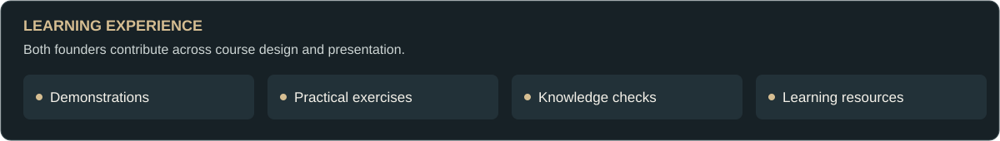

We share curriculum planning, lesson preparation, demonstrations, recording and learning resources. 

---

## 

<a href="https://www.fiverr.com/haziq_afzal/enhance-your-github-profile-and-repository-readme">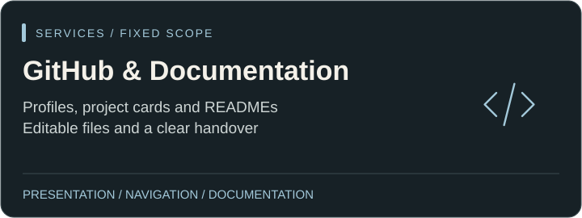</a> <a href="https://www.fiverr.com/ruveehaashfaq">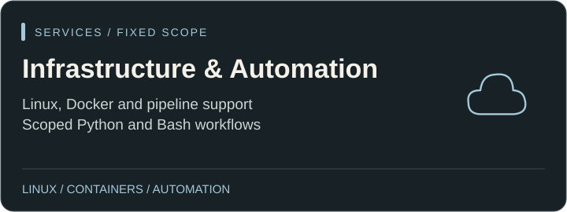</a>

**GitHub profiles & repository documentation** — editable READMEs, project presentation, selected graphics and clear setup or usage guidance.  
 &nbsp; 

**Infrastructure support** — investigate a defined Linux or container issue, check the result and document the work.  
 &nbsp; 

**Automation & delivery** — scoped scripts or troubleshooting an existing pipeline.  
 &nbsp; 

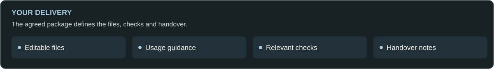

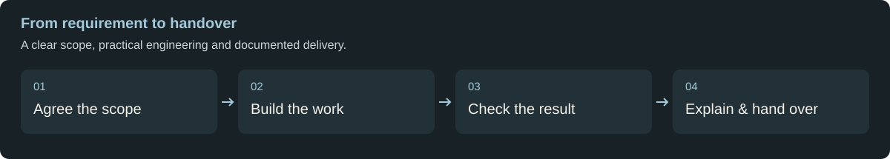

Share your requirement, environment and target date. We agree on scope, a fixed price and delivery timing, then provide the agreed editable files, relevant checks and handover guidance. Package limits apply.

---

## 

<a href="https://github.com/HaziqBinAfzal">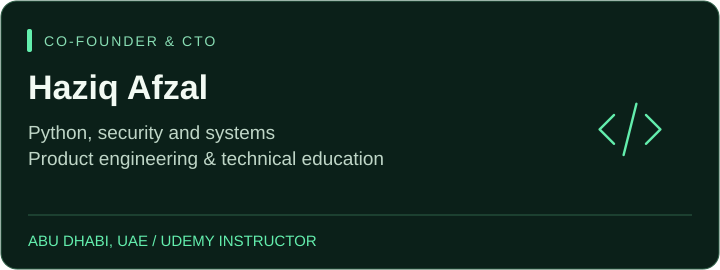</a> <a href="https://github.com/ruveeha33">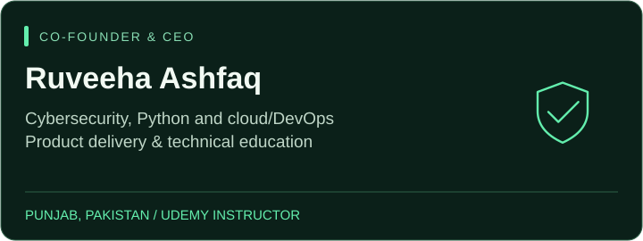</a>

**Haziq Afzal · Co-Founder & CTO · Udemy Instructor**  
Technical strategy, Python engineering, defensive security, Linux/DevOps and product development. Based in Abu Dhabi, UAE.  
 &nbsp;  &nbsp;  &nbsp; 

**Ruveeha Ashfaq · Co-Founder & CEO · Udemy Instructor**  
Company direction, product delivery and hands-on work across cybersecurity, Python, Linux, cloud/DevOps and automation. Based in Mandi Bahauddin, Pakistan.  
 &nbsp;  &nbsp;  &nbsp; 

Both founders share product ownership and credit across engineering, services and education.

---

## 

<a href="./assets/dynamic/data.json">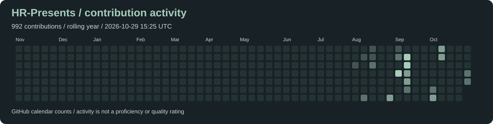</a>

<a href="https://github.com/HR-Presents/AegisLog">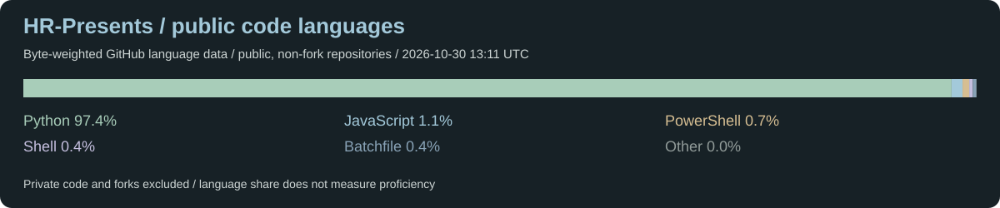</a>

Repository-hosted graphics refresh automatically every six hours. Cards show the last successful refresh; contributions cover the rolling year, while languages cover public non-fork repositories. Historical test evidence above remains dated and does not claim a new test run.

---

## 

**Both founders:** AIOPS Level 6 — Artificial Intelligence, Al Nafi International College; in progress, August 2025–February 2027 expected.

**Haziq:** completed the EduQual Level 3 Diploma in Cloud Cyber Security, June–August 2024, Grade B.  
**Ruveeha:** completed Matric, Biology at Army Public School, Grade A+.

Our learning covers Linux administration, cloud, cybersecurity, DevOps, AI/data and OT/ICS concepts. We apply it through controlled labs and documented projects. 

### 

**Haziq:** .

**Ruveeha:**  &nbsp;  &nbsp;  &nbsp;  &nbsp; .

Training badges and course completions are distinct from professional certification exams.

Haziq’s background includes school science-project awards and community learning participation. Ruveeha’s includes English Olympiad preliminary-round participation and Kaggle achievements.  &nbsp; 

---

## 

For products, engineering services or technical education, tell us what you want to achieve.

** &nbsp;  &nbsp;  &nbsp; **

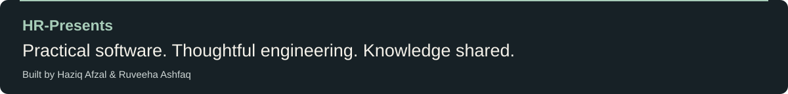

### Shared products & courses

<!-- SHARED-CONTENT:START -->
**Sentrix V1** — Python security and code-quality review with structured findings and reports.  

**AegisLog** — Local defensive log investigation, retained evidence and HTML reports.  

**Docker Pro Skills** — Build, secure and deploy applications with containers, Compose and practical labs.  

**Think Before You Click** — Online safety through scam recognition, account protection and practical scenarios.  

<!-- SHARED-CONTENT:END -->

