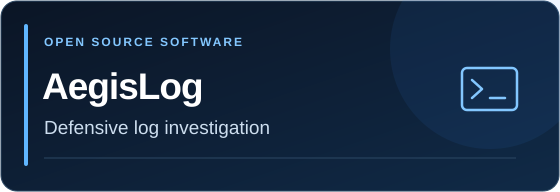
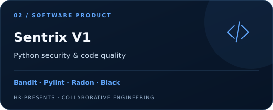
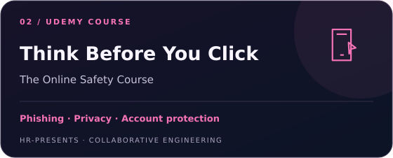

# HR-Presents

**Practical software. Clear technical learning. Better developer experiences.**

[Products](#featured-products) · [Courses](#our-udemy-courses) · [Services](#work-with-us) · [Tech stack](#tech-stack) · [Founders](#founders) · [Background](company-background.md)

---

We build defensive security and developer tools, create practical technology courses, and help people present and document their engineering work. **Haziq Afzal and Ruveeha Ashfaq founded and build HR-Presents together.**

## Featured products

<table>
<tr>
<td width="50%" valign="top">

Investigate supported logs and accessible Windows, Linux and Docker telemetry locally. Review retained evidence, investigation timelines and readable HTML reports.

<strong>Free · MIT licensed · Terminal-first</strong>

<a href="https://github.com/HR-Presents/AegisLog">Source &amp; documentation</a> · <a href="https://github.com/HR-Presents/AegisLog/releases/latest">Downloads</a> · <a href="https://github.com/HR-Presents/AegisLog/blob/main/docs/QUICKSTART.md">Beginner guide</a>

</td>
<td width="50%" valign="top">

Review Python security, code quality, complexity, formatting and syntax through a local browser workspace. Combines Bandit, Pylint, Radon and Black with structured reporting.

<strong>Commercial product · Local browser workspace</strong>

<a href="https://www.linkedin.com/posts/hr-presents_sentrix-hrpresents-python-activity-7495086599194558465-6ZIc">Public demonstration</a> · <a href="https://www.linkedin.com/company/hr-presents/">Discuss editions &amp; licensing</a>

</td>
</tr>
</table>

**[Product details & engineering practices →](company-background.md#released-products)**

AegisLog preserves source logs; its findings support human investigation. Sentrix standards mappings provide engineering context.

## Our Udemy courses

Co-created and co-presented by **Haziq Afzal and Ruveeha Ashfaq** under HR-Presents.

<table>
<tr>
<td width="50%" valign="top">

From your first container to application delivery: Dockerfiles, Compose, volumes, networking, security, troubleshooting and CI/CD.

Practical labs, quizzes and an e-commerce capstone, with NGINX, Swarm and Kubernetes fundamentals.

<a href="https://www.udemy.com/course/docker-mastery-from-beginner-to-job-ready/">Explore the Docker course →</a>

</td>
<td width="50%" valign="top">

Recognize scams, phishing, suspicious websites and impersonation. Build better habits around accounts, privacy, AI deepfakes and everyday online decisions.

Fictional scenarios, missions, quizzes and downloadable safety resources. <strong>Pause. Verify. Protect.</strong>

<a href="https://www.udemy.com/course/think-before-you-click-the-online-safety-course/">Explore the online safety course →</a>

</td>
</tr>
</table>

Our shared work includes lesson preparation, demonstrations, recording, quizzes, presentations and downloadable practice materials.

**[Visit our Udemy instructor page →](https://www.udemy.com/user/haziq-x-ruveeha/)**

## Work with us

We work together on agreed technical projects, from understanding your requirement to implementation, documentation and handover.

| Service | What we help with |
| :--- | :--- |
| **GitHub profiles & developer presentation** | Profile READMEs, featured project layouts, selected banners and clear project descriptions |
| **Repository documentation** | Installation and usage guides, organized READMEs, project navigation and handover notes |
| **Linux, Docker & DevOps support** | Setup guidance, container and Compose troubleshooting, automation and existing CI/CD workflow investigation |
| **Custom software** | Defensive tools, Python automation and software workflows scoped around your requirements |

[Discuss a project on LinkedIn](https://www.linkedin.com/company/hr-presents/) · [Haziq's services](https://www.fiverr.com/haziq_afzal) · [Ruveeha's services](https://www.fiverr.com/ruveehaashfaq)

## Tech stack

**Programming & automation**

**Linux, cloud & DevOps**

**Security & analysis**

Tools across our products, engineering work and labs. Usage varies by project. [Broader technical foundation](company-background.md#technical-foundation).

## Founders

| Haziq Afzal | Ruveeha Ashfaq |
| --- | --- |
| **Co-Founder & CTO** | **Co-Founder & CEO** |
| Technical strategy, software engineering, cybersecurity and product development. | Company direction, operations, product delivery and customer experience. |
| [GitHub](https://github.com/HaziqBinAfzal) · [LinkedIn](https://www.linkedin.com/in/haziq-afzal-010b6636a) | [GitHub](https://github.com/ruveeha33) · [LinkedIn](https://www.linkedin.com/in/ruveeha-ashfaq-632b15378) |

Both founders collaborate across products, course creation, technical work and documentation.

## Engineering background

<strong>Products, release practices, technical study &amp; principles</strong>

Our work spans defensive security, secure development, automation, cloud, DevOps, AI and data workflows. We apply technical study through software, labs, documentation and releases.

- [Detailed product capabilities and availability](company-background.md#released-products)
- [What we build](company-background.md#what-we-build)
- [Technology stack and broader exposure](company-background.md#technology-stack)
- [Engineering and release practices](company-background.md#engineering--release-practice)
- [Technical foundation and continuing study](company-background.md#technical-foundation)
- [Engineering principles](company-background.md#engineering-principles)

The detailed page retains the existing product information, learning context, release notes and verification limitations.

## Stay connected

[Company updates & demonstrations](https://www.linkedin.com/company/hr-presents/) · [GitHub projects](https://github.com/HR-Presents) · [Udemy courses](https://www.udemy.com/user/haziq-x-ruveeha/)

