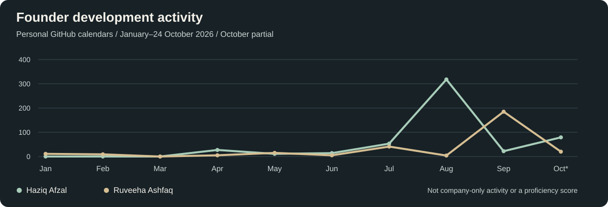
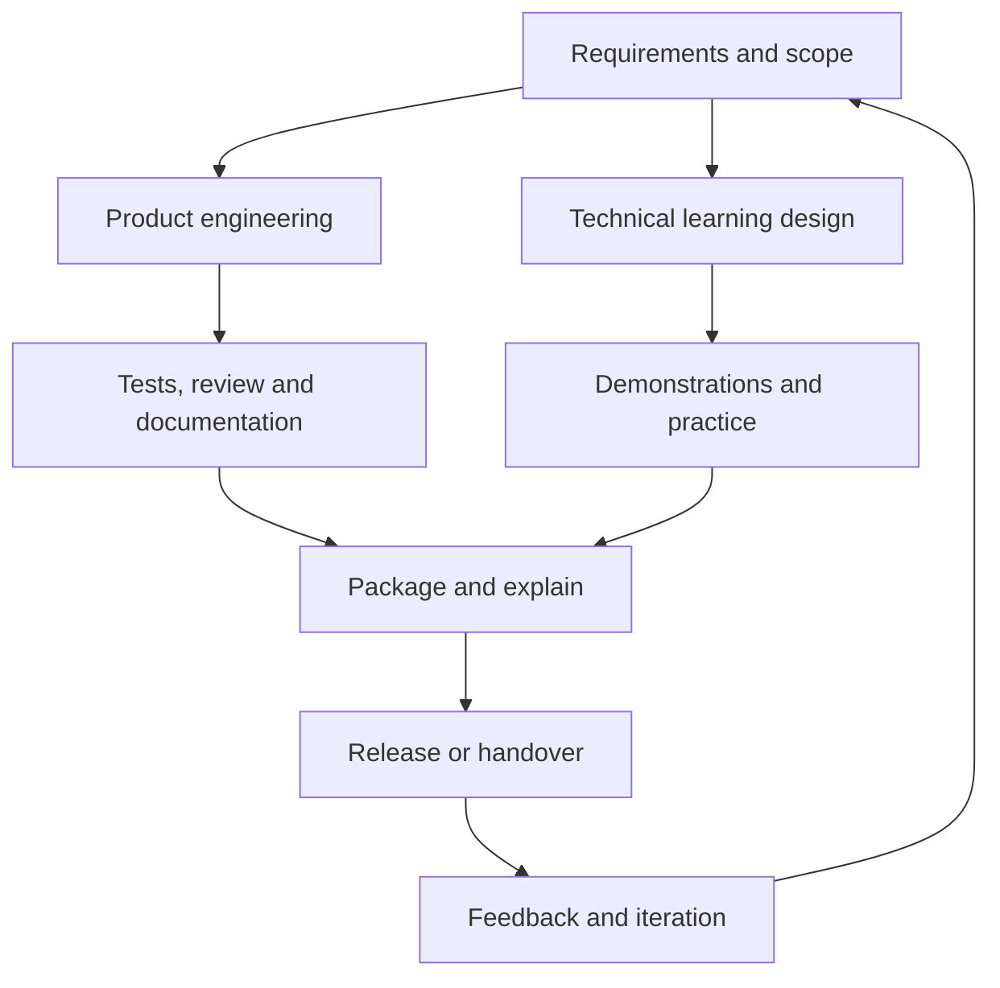

**Built by Haziq Afzal & Ruveeha Ashfaq**

Python products · Defensive security · Linux & DevOps · Technical education

[Products](#products) · [Engineering](#projects) · [Technology](#tech-stack) · [Courses](#courses) · [Services](#services) · [Founders](#founders) · [Activity](#activity)

We build practical security tools, automate technical workflows and teach the skills behind them. Explore our products and collaborative engineering below.

## Our products

<table>
<tr><td width="50%" valign="top">
Joint HR-Presents commercial product. Review Python security, quality, complexity, formatting and syntax, with structured findings and downloadable reports.
</td>
<td width="50%" valign="top">
Joint HR-Presents open-source product. Analyze supported files and accessible native telemetry locally, then review explained findings and retained-evidence reports.
</td></tr>
</table>

**Sentrix:** [Product details](https://github.com/HaziqBinAfzal/HaziqBinAfzal/blob/main/docs/case-studies/sentrix.md) · **AegisLog:** [Documentation & downloads](https://github.com/HR-Presents/AegisLog)

---

## Engineering portfolio

<table>
<tr><td width="50%" valign="top">
Educational water and desalination evidence analysis with Python, Flask, Docker, SHA-256 provenance and observability. Haziq: project author; Ruveeha: contributor.
</td>
<td width="50%" valign="top">
Ruveeha’s educational project for evidence provenance, analysis rules, statistical screening, reports and observability.
</td></tr>
<tr><td width="50%" valign="top">
rsync, tar, GPG, SHA-256, SSH, cron and documented restoration. Team: Haziq, Ruveeha, Ambreen Imtiaz and Muhammad Buddha.
</td>
<td width="50%" valign="top">
Ruveeha: Flask backend/API; Haziq: frontend/API integration; Ambreen Imtiaz: classification and AI logic.
</td></tr>
</table>

**More work:** [LinuxOps Enterprise Lab](https://github.com/HaziqBinAfzal/linuxops-enterprise-lab) · [SFVDS](https://github.com/HaziqBinAfzal/sfvds) · [Jira automation](https://github.com/HaziqBinAfzal/jira-python-automation-bot) · [Smart Mount Manager](https://github.com/HaziqBinAfzal/Smart_Mount_Manager)

Project credits, operating limits & verification

### More engineering work

| Project | Purpose and implementation | People and evidence |
| --- | --- | --- |
| **[LinuxOps Enterprise Lab](https://github.com/HaziqBinAfzal/linuxops-enterprise-lab)** | Collaborative Linux administration and documented system baselines | Haziq: Ubuntu. Ruveeha: Rocky Linux. Phase 01 is documented; later phases are planned |
| **[AI Log Analyzer](https://github.com/ruveeha33/AI-Log-Analyzer)** | Collaborative log-analysis application with a Flask backend, frontend/API integration and classification logic | Ruveeha: backend/API. Haziq: frontend/API integration. Ambreen Imtiaz: classification and AI logic |
| **[SFVDS](https://github.com/HaziqBinAfzal/sfvds)** | Bash/Linux file versioning and change monitoring with SHA-256, inotifywait, backups, rollback and logging | Haziq Afzal, Ruveeha Ashfaq and Ambreen Imtiaz |
| **[Jira Python Automation Bot](https://github.com/HaziqBinAfzal/jira-python-automation-bot)** | Python REST API work for Jira issue creation and workflow tasks | Haziq Afzal and Ruveeha Ashfaq |
| **[Smart Mount Manager](https://github.com/HaziqBinAfzal/Smart_Mount_Manager)** | Additional Linux tooling in our personal project portfolio | See the repository for implementation and authorship |

AquaVigil and NuclearShield are educational evidence-analysis demonstrations. They do not operate water infrastructure or nuclear facilities.

**Explore the full demonstrations:** [Haziq’s gallery](https://github.com/HaziqBinAfzal/HaziqBinAfzal/blob/main/docs/demo-gallery.md) · [Ruveeha’s gallery](https://github.com/ruveeha33/ruveeha33/blob/main/demo-gallery.md)

### Verification and engineering evidence

We link test records to their dates and environments so visitors can inspect what was actually checked.

| Record | Documented result | Scope |
| --- | --- | --- |
| [Haziq’s verification record · 24 October 2026](https://github.com/HaziqBinAfzal/HaziqBinAfzal/blob/main/docs/verification/2026-10-24/README.md) | AegisLog: 689 tests passed; AquaVigil: 14 passed, 361 warnings | Dated synthetic Linux source runs; not a current release-wide guarantee |
| [Ruveeha’s verification record · 24 October 2026](https://github.com/ruveeha33/ruveeha33/blob/main/verification.md) | NuclearShield: 34 tests passed | Dated Linux source run with retained context |
| [AegisLog workflows](https://github.com/HR-Presents/AegisLog/actions) | Current workflow runs and job results | Inspect the selected commit and run |
| [AegisLog releases](https://github.com/HR-Presents/AegisLog/releases) | Published packages, release notes and checksums | Choose the exact release and asset |

---

## Technology

**Programming & automation**

**Linux, cloud & delivery**

**Systems, APIs & observability**

**Code analysis & investigation**

<strong>Additional tools, practice areas & ongoing study</strong>

**Additional infrastructure tools used across labs and learning**

**AI & data study**

**Practice areas**

Cloud computing · Linux administration · CI/CD · cybersecurity · log analysis · incident investigation · Python and security automation · backup and recovery · syntax validation · secure development.

Tools and topics span products, collaborative projects, labs and ongoing study; experience varies by project. [Technical foundation and learning context](company-background.md#technical-foundation).

---

## Courses

Co-created and co-presented by **Haziq Afzal and Ruveeha Ashfaq** under HR-Presents.

<table>
<tr>
<td width="50%" valign="top">

Dockerfiles, Compose, storage, networking, security and CI/CD, supported by labs, quizzes and an e-commerce capstone.

<a href="https://www.udemy.com/course/docker-mastery-from-beginner-to-job-ready/"><strong>View the Docker course</strong></a>

</td>
<td width="50%" valign="top">

Scams, phishing, account protection, privacy and AI deception, explored through fictional missions, quizzes and downloadable resources.

<a href="https://www.udemy.com/course/think-before-you-click-the-online-safety-course/"><strong>View the online safety course</strong></a>

</td>
</tr>
</table>

We co-create the curriculum, demonstrations, quizzes and downloadable practice resources. [Our Udemy profile](https://www.udemy.com/user/haziq-x-ruveeha/).

---

## Work with our team

<table>
<tr><td width="50%" valign="top">
Profile and repository presentation, selected graphics and clear technical documentation.
</td>
<td width="50%" valign="top">
Linux and Docker troubleshooting, automation and CI/CD support within an agreed scope.
</td></tr>
</table>

**GitHub enhancement:** [Haziq](https://www.fiverr.com/haziq_afzal/enhance-your-github-profile-and-repository-readme) · [Ruveeha](https://www.fiverr.com/ruveehaashfaq/redesign-your-github-profile-and-repository-readme)  
**Support:** [Linux](https://www.fiverr.com/ruveehaashfaq/troubleshoot-linux-server-issues-ssh-permissions-and-services) · [Docker](https://www.fiverr.com/ruveehaashfaq/troubleshoot-docker-containers-and-docker-compose-applications) · [Python & Bash](https://www.fiverr.com/haziq_afzal/write-python-and-bash-scripts-to-automate-repetitive-tasks) · [CI/CD](https://www.fiverr.com/haziq_afzal/troubleshoot-github-actions-and-jenkins-ci-cd-pipelines)

Delivered jointly, with an agreed scope, fixed price and handover.

Service scope, deliverables & how we work

Work delivered jointly by Haziq Afzal and Ruveeha Ashfaq. Share your requirement before ordering; we agree on deliverables, a fixed price and a delivery date.

**GitHub profiles and repository documentation**  
Editable READMEs, project presentation, selected graphics, installation and usage guidance, and handover notes within the agreed scope.  
[Haziq’s GitHub service](https://www.fiverr.com/haziq_afzal/enhance-your-github-profile-and-repository-readme) · [Ruveeha’s GitHub service](https://www.fiverr.com/ruveehaashfaq/redesign-your-github-profile-and-repository-readme)

**Linux and Docker support**  
Investigation of a defined issue, agreed changes or commands, checks and written findings.  
[Linux troubleshooting](https://www.fiverr.com/ruveehaashfaq/troubleshoot-linux-server-issues-ssh-permissions-and-services) · [Docker and Compose support](https://www.fiverr.com/ruveehaashfaq/troubleshoot-docker-containers-and-docker-compose-applications)

**Automation and CI/CD**  
Scoped Python or Bash scripts with usage guidance, or investigation of an existing GitHub Actions or Jenkins workflow.  
[Python and Bash automation](https://www.fiverr.com/haziq_afzal/write-python-and-bash-scripts-to-automate-repetitive-tasks) · [CI/CD troubleshooting](https://www.fiverr.com/haziq_afzal/troubleshoot-github-actions-and-jenkins-ci-cd-pipelines)

### What you receive

| Deliverable | What it means |
| --- | --- |
| **Editable source** | Agreed Markdown, scripts, configuration or other working files |
| **Documentation** | Relevant setup, usage, troubleshooting or project guidance |
| **Selected visuals** | Graphics and project presentation where included in the agreed package |
| **Verification** | Checks relevant to the task, with findings and remaining limitations |
| **Handover** | A clear record of the changes and how to use the delivered work |

**Custom software**  
Discuss defensive tools or software workflows tailored to your requirements.  
[Contact HR-Presents](https://www.linkedin.com/company/hr-presents/)

How an engagement works

1. Share the repository or task, desired result, relevant environment and target date.
2. Agree on deliverables, price, package limits and delivery date.
3. We develop the agreed work and review it against the requirement.
4. Receive the agreed editable files, usage guidance and handover notes.

Exact package limits on the selected listing apply.

[See our own profile redesign case study](profile-redesign-case-study.md)

---

## The people behind HR-Presents

<table><tr>
<td width="50%" valign="top">
Technical strategy, Python engineering, defensive security and Linux/DevOps.

<a href="https://github.com/HaziqBinAfzal">GitHub</a> · <a href="https://www.linkedin.com/in/haziq-afzal/">LinkedIn</a> · <a href="https://www.fiverr.com/haziq_afzal">Fiverr</a>
</td>
<td width="50%" valign="top">
Company direction, product delivery, cybersecurity and hands-on development.

<a href="https://github.com/ruveeha33">GitHub</a> · <a href="https://www.linkedin.com/in/ruveeha-ashfaq/">LinkedIn</a> · <a href="https://www.fiverr.com/ruveehaashfaq">Fiverr</a>
</td>
</tr></table>

We share product ownership, engineering work and teaching responsibilities.

Our full professional backgrounds

## Meet the founders

### Haziq Afzal

**Co-Founder & CTO · Udemy Instructor · Abu Dhabi, UAE**

Haziq works across Python applications, defensive security, Linux systems, cloud/DevOps, automation and observability. His founder responsibilities include technical strategy and product development, alongside hands-on implementation, testing, troubleshooting and documentation.

[GitHub](https://github.com/HaziqBinAfzal) · [LinkedIn](https://www.linkedin.com/in/haziq-afzal/) · [Fiverr](https://www.fiverr.com/haziq_afzal) · [Full professional background](https://github.com/HaziqBinAfzal/HaziqBinAfzal/blob/main/docs/professional-background.md)

### Ruveeha Ashfaq

**Co-Founder & CEO · Udemy Instructor · Mandi Bahauddin, Pakistan**

Ruveeha works across cybersecurity, Python, Linux, Docker, cloud/DevOps, AI and automation. Her founder responsibilities include company direction, coordination and product delivery, alongside hands-on development, testing, troubleshooting and documentation.

[GitHub](https://github.com/ruveeha33) · [LinkedIn](https://www.linkedin.com/in/ruveeha-ashfaq/) · [Fiverr](https://www.fiverr.com/ruveehaashfaq) · [Full professional background](https://github.com/ruveeha33/ruveeha33/blob/main/professional-background.md)

Both founders share ownership and credit across products, services and technical education.

---

## Building in public

The graph uses dated contribution-calendar records from both personal profiles. It includes all activity recorded in those calendars, rather than company-only work. October is partial. [Source and monthly values](assets/company/activity-data.json).

Engineering process & company milestones

### Engineering workflow

### Company milestones

| Milestone | Record |
| --- | --- |
| **2026 — Founded HR-Presents** | Haziq Afzal and Ruveeha Ashfaq begin their shared technology collaboration |
| **Software products** | Sentrix V1 and AegisLog connect development, investigation and reporting |
| **Technical education** | Co-created Docker Pro Skills and Think Before You Click |
| **Engineering portfolio** | Educational security projects, Linux workflows and collaborative automation |
| **Fixed-scope services** | GitHub presentation, documentation, Linux/Docker support and automation |

---

## Background & continued learning

Both founders are pursuing **AIOPS Level 6 — Artificial Intelligence at Al Nafi International College**. Our experience develops through products, coursework, controlled labs and collaborative projects.

Company background, education, credentials & recognition

## About HR-Presents

HR-Presents is an independent technology collaboration founded in 2026. Our shared work connects defensive cybersecurity, software development, Linux systems, cloud/DevOps, automation and technical education.

Both founders contribute across planning, implementation, testing, troubleshooting, documentation and releases. The CTO and CEO roles describe our responsibilities within the team; product ownership and credit are shared.

### What guides our work

| Principle | In practice |
| --- | --- |
| **Shared ownership** | Both founders contribute and receive credit |
| **Explainable results** | Findings retain context, evidence and limits |
| **Practical delivery** | Useful files, documentation and clear handover |
| **Respect for contributors** | Team roles and upstream authorship stay visible |
| **Continuous learning** | Coursework develops through projects and controlled labs |

### How we build

| Stage | Our approach |
| --- | --- |
| Understand | Define the user’s problem, environment, inputs and intended result |
| Scope | Agree on features, deliverables, constraints and a fixed price for service work |
| Implement | Build readable code, documentation and workflows around the requirement |
| Check | Use relevant tests, linting, security checks and reproducible examples |
| Package | Prepare installation guidance, versioned releases or editable handover files |
| Explain | Document evidence, operating limits, usage and next steps |

Our principles are practical: preserve source evidence, explain findings, credit collaborators, keep documentation usable and distinguish implemented work from planned features.

## Education & technical development

| Founder | Education | Status |
| --- | --- | --- |
| **Haziq Afzal** | AIOPS Level 6 — Artificial Intelligence, Al Nafi International College | In progress; Aug 2025–Feb 2027 expected |
| **Haziq Afzal** | EduQual Level 3 Diploma in Cloud Cyber Security, Al Nafi International College | Completed; Jun–Aug 2024; Grade B |
| **Ruveeha Ashfaq** | AIOPS Level 6 — Artificial Intelligence, Al Nafi International College | In progress; Aug 2025–Feb 2027 expected |
| **Ruveeha Ashfaq** | Matric, Biology — Army Public School (APSACS) | Completed; Grade A+ |

Our practical experience develops through coursework, labs, collaborative projects and product development.

<strong>Explore our study and practical exposure</strong>

### Areas of study and practical exposure

| Area | Topics |
| --- | --- |
| **Linux and systems** | Administration, networking, permissions, services, SSH, storage, troubleshooting, backup and restoration |
| **Cybersecurity** | Defensive investigation, access control, cloud security, SIEM/SOC concepts, incident response, vulnerability assessment and secure development |
| **Cloud** | AWS architecture and services, IAM, networking, compute, storage, monitoring and Azure administration study |
| **DevOps** | Docker, Compose, Git, CI/CD, infrastructure automation, Kubernetes and observability |
| **AI and data** | Python, statistics, data handling, machine learning, deep learning, NLP, computer vision and deployment concepts |
| **OT / ICS** | SCADA security, evidence analysis, process context and study informed by NIST SP 800-82 and ISO guidance |
| **Governance** | Standards and control frameworks studied in context, including NIST, ISO, CIS and PCI DSS |

Study areas describe our learning foundation. Project repositories show where a topic has been implemented. Training in a framework does not imply professional certification or regulatory approval.

## Training records & credentials

<strong>View both founders’ training records</strong>

### Haziq Afzal

| Record | Issuer | Evidence |
| --- | --- | --- |
| AWS Knowledge: Amazon ECS Trained | AWS · Sep 2026 | [Credly training badge](https://www.credly.com/badges/1a9facfe-2f4e-4ab0-b9c2-70d6cd7904f9/public_url) |

### Ruveeha Ashfaq

| Record | Issuer | Evidence |
| --- | --- | --- |
| AWS Knowledge: Amazon ECS Trained | AWS · Sep 2026 | [Credly training badge](https://www.credly.com/badges/98503ff9-557c-4649-959d-9dc0086a5173/public_url) |
| AWS Cloud Quest: Cloud Practitioner | AWS · Dec 2025 | [Credly training badge](https://www.credly.com/badges/87ff6ebc-a5c2-4770-b61b-e190cf00d218/public_url) |
| AWS Cloud Quest: Generative AI Practitioner | AWS · Dec 2025 | [Credly training badge](https://www.credly.com/badges/4fcb5de6-8345-406b-b7b0-87a44c5af982/public_url) |
| AWS Cloud Practitioner Essentials | AWS · Nov 2025 | [Course completion context](https://github.com/ruveeha33/ruveeha33/blob/main/professional-background.md#credentials-and-course-completions) |
| CC Domains 1–4: Security Principles; Incident Response, Business Continuity and Disaster Recovery; Access Control; Network Security | ISC2 · Nov 2025 | [Training evidence](https://github.com/ruveeha33/ISC2-CC-Training-Certs-Repo) |
| Linux For Absolute Beginners; Docker For Absolute Beginners | KodeKloud · Nov 2025 | [Course completion details](https://github.com/ruveeha33/ruveeha33/blob/main/professional-background.md#credentials-and-course-completions) |

These are training badges and course completions. They are distinct from AWS certification exams and the ISC2 Certified in Cybersecurity credential.

<strong>View recognition and community participation</strong>

### Recognition & community participation

**Haziq:** school recognition includes first-place Science & Math Project awards in Category 3 at the February 2023 Science & Arts Exhibition, a Book Tasting presenter appreciation certificate, drawing competition recognition and participation in spelling and community learning activities. [Full recognition record](https://github.com/HaziqBinAfzal/HaziqBinAfzal/blob/main/docs/professional-background.md#honors-and-participation).

**Ruveeha:** preliminary-round participation in the 9th International English Language Olympiad, plus Kaggle community participation and a Python Coder platform achievement. [Recognition details](https://github.com/ruveeha33/ruveeha33/blob/main/professional-background.md#recognition).

**Languages:** Haziq’s profile lists English at professional working proficiency and Urdu at native or bilingual proficiency. Both detailed founder background pages above include further experience and contributor records.

## Let’s work together

Share your project, desired result and target date. We’ll discuss an achievable scope and fixed price.

**[Haziq on Fiverr](https://www.fiverr.com/haziq_afzal) · [Ruveeha on Fiverr](https://www.fiverr.com/ruveehaashfaq) · [Company LinkedIn](https://www.linkedin.com/company/hr-presents/)**

Frequently asked questions

**Do both founders deliver the work?**  
We collaborate as HR-Presents and agree on responsibilities for each task.

**Are services hourly?**  
Our Fiverr engagements use the fixed packages or custom scope agreed before ordering.

**Can you work on an existing repository?**  
Yes, within an agreed scope that respects source code, history, contributor credits and the project’s requirements.

**Are the security demonstrations production control systems?**  
AquaVigil and NuclearShield are educational evidence-analysis projects.

**Where can I verify experience and training?**  
Use the linked project repositories, dated verification records, founder backgrounds and training evidence.

---

<strong>HR-Presents · Engineering together. Teaching what we build.</strong>

