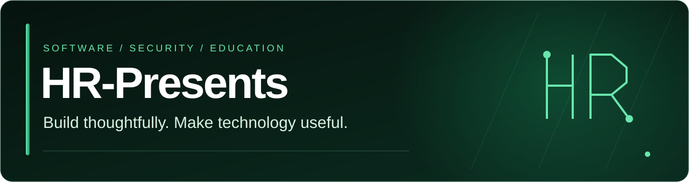
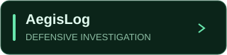
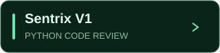
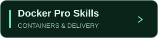

# HR-Presents

**Tools for technical work. Courses for practical skills. Solutions built together.**

[Products](#products) · [Product gallery](product-gallery.md) · [Courses](#courses) · [Services](#services) · [Tech stack](#tech-stack) · [Founders](#founders)

**HR-Presents** is founded and built together by **Haziq Afzal** and **Ruveeha Ashfaq**. We develop defensive security and developer tools, create hands-on technology courses, and help people present and document their engineering work.

## Featured products

 

<table>
<tr>
<td width="50%" valign="top">

Investigate supported logs and accessible Windows, Linux and Docker telemetry. Review retained evidence, incident context and local HTML reports.

<strong>Local · Read-only source access · MIT</strong>

<a href="https://github.com/HR-Presents/AegisLog/releases/latest"><strong>Download AegisLog →</strong></a>

<a href="https://github.com/HR-Presents/AegisLog">Source &amp; docs</a> · <a href="product-gallery.md#aegislog">Full-size demo</a>

</td>
<td width="50%" valign="top">

Review Python security, quality, complexity, formatting and syntax with Bandit, Pylint, Radon and Black, plus structured findings and reports.

<strong>Local browser workspace · Commercial</strong>

<a href="https://www.linkedin.com/posts/hr-presents_sentrix-hrpresents-python-activity-7495086599194558465-6ZIc"><strong>Watch Sentrix in action →</strong></a>

<a href="https://www.linkedin.com/company/hr-presents/">Editions &amp; licensing</a> · <a href="product-gallery.md#sentrix-v1">Full-size product image</a>

</td>
</tr>
</table>

**[Explore the product gallery →](product-gallery.md)** Original media, full-size previews, demonstrations and product context.

## Our Udemy courses

**Co-created and co-presented by Haziq Afzal and Ruveeha Ashfaq.**

 

Select a course above, then expand its panel for the cover, topics and enrollment link.

<strong>Docker Pro Skills — Build, Secure &amp; Deploy Applications</strong>

Containers, Dockerfiles, Compose, networking, storage, security and CI/CD—with practical labs, quizzes and an e-commerce capstone.

**Explore:** container fundamentals · application builds · deployment workflows · practical troubleshooting.

**[Explore the Docker course on Udemy →](https://www.udemy.com/course/docker-mastery-from-beginner-to-job-ready/)**

[Online Safety panel ↓](#course-safety) · [All HR-Presents courses](https://www.udemy.com/user/haziq-x-ruveeha/)

<strong>Think Before You Click — The Online Safety Course</strong>

Scams, phishing, account protection, privacy and AI deception—practiced through fictional missions, quizzes and downloadable resources.

**Explore:** suspicious messages · safer accounts · digital privacy · everyday decisions. **Pause. Verify. Protect.**

**[Explore the Online Safety course on Udemy →](https://www.udemy.com/course/think-before-you-click-the-online-safety-course/)**

[Docker panel ↑](#course-docker) · [All HR-Presents courses](https://www.udemy.com/user/haziq-x-ruveeha/)

Our shared teaching work includes preparation, demonstrations, recording, quizzes and downloadable learning materials.

## Work with HR-Presents

Bring your requirement. We agree on the scope, develop the solution, review the work and provide handover guidance.

<table>
<tr>
<td width="50%" valign="top">
<h3>GitHub &amp; developer presentation</h3>

Profile READMEs, featured-project layouts, selected banners and clearer developer portfolios.

<a href="profile-redesign-case-study.md">View our own profile redesign case study →</a>
</td>
<td width="50%" valign="top">
<h3>Repository documentation</h3>

Installation and usage guides, organized READMEs, project navigation and handover notes.

<a href="https://github.com/HR-Presents/AegisLog">Explore our open-source documentation →</a>
</td>
</tr>
<tr>
<td width="50%" valign="top">
<h3>Linux, Docker &amp; automation</h3>

Setup guidance, container and Compose troubleshooting, Python automation and existing CI/CD investigation.

<a href="https://www.linkedin.com/company/hr-presents/">Discuss your workflow →</a>
</td>
<td width="50%" valign="top">
<h3>Custom software</h3>

Defensive tools and software workflows scoped around your requirements and practical constraints.

<a href="https://www.linkedin.com/company/hr-presents/">Discuss your project →</a>
</td>
</tr>
</table>

**[Start a project conversation →](https://www.linkedin.com/company/hr-presents/)** · [Haziq on Fiverr](https://www.fiverr.com/haziq_afzal) · [Ruveeha on Fiverr](https://www.fiverr.com/ruveehaashfaq)

## Tech stack

**Programming & automation**

**Linux, cloud & delivery**

**Code analysis & investigation**

<strong>Additional tools, practice areas & ongoing study</strong>

**Additional infrastructure tools used across labs and learning**

**AI & data study**

**Practice areas**

Cloud computing · Linux administration · CI/CD · cybersecurity · log analysis · incident investigation · Python and security automation · backup and recovery · syntax validation · secure development.

Tools and topics span products, collaborative projects, labs and ongoing study; experience varies by project. [Technical foundation and learning context](company-background.md#technical-foundation).

## The founders

**Haziq Afzal — Co-Founder & CTO · Udemy Instructor**  
Technical strategy, software engineering, cybersecurity and product development.  
[GitHub](https://github.com/HaziqBinAfzal) · [LinkedIn](https://www.linkedin.com/in/haziq-afzal/)

**Ruveeha Ashfaq — Co-Founder & CEO · Udemy Instructor**  
Company direction, operations, product delivery and customer experience.  
[GitHub](https://github.com/ruveeha33) · [LinkedIn](https://www.linkedin.com/in/ruveeha-ashfaq/)

Both founders collaborate across product development, testing, documentation and technical education.

## Engineering background

<strong>Products, engineering practices & continued learning</strong>

[Product details](company-background.md#released-products) · [Engineering and release practices](company-background.md#engineering--release-practice) · [Technical foundation](company-background.md#technical-foundation) · [Engineering principles](company-background.md#engineering-principles)

<strong><a href="https://www.linkedin.com/company/hr-presents/">Discuss a project</a></strong> · <a href="https://www.udemy.com/user/haziq-x-ruveeha/">Learn with us</a> · <a href="#products">Explore our products</a>

