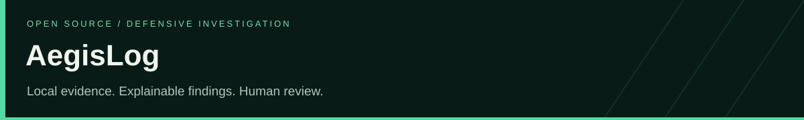
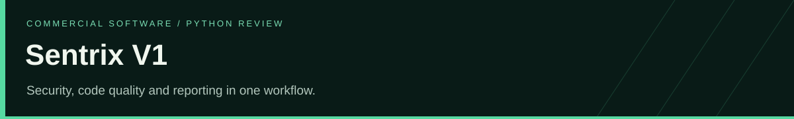
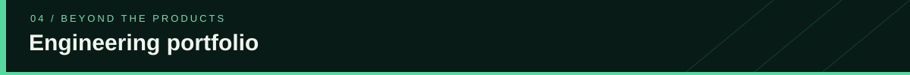

# HR-Presents

**Software engineering, cybersecurity and technical education.**

Founded by **Haziq Afzal and Ruveeha Ashfaq**, HR-Presents brings together software products, practical technical education and fixed-scope engineering services. We build tools for Python code review and defensive log investigation, document Linux and automation workflows, and help people present and maintain their technical work.

[Services](#services) · [Portfolio](#portfolio) · [Products](#products) · [Projects](#projects) · [Courses](#courses)  
[Technology](#tech-stack) · [Founders](#founders) · [Education](#education) · [Training](#training) · [Contact](#contact)

**[Discuss your GitHub project with Haziq](https://www.fiverr.com/haziq_afzal/enhance-your-github-profile-and-repository-readme) · [Discuss your GitHub project with Ruveeha](https://www.fiverr.com/ruveehaashfaq/redesign-your-github-profile-and-repository-readme)**

---

## Services

Work delivered jointly by Haziq Afzal and Ruveeha Ashfaq. Share your requirement before ordering; we agree on deliverables, a fixed price and a delivery date.

**GitHub profiles and repository documentation**  
Editable READMEs, project presentation, selected graphics, installation and usage guidance, and handover notes within the agreed scope.  
[Haziq’s GitHub service](https://www.fiverr.com/haziq_afzal/enhance-your-github-profile-and-repository-readme) · [Ruveeha’s GitHub service](https://www.fiverr.com/ruveehaashfaq/redesign-your-github-profile-and-repository-readme)

**Linux and Docker support**  
Investigation of a defined issue, agreed changes or commands, checks and written findings.  
[Linux troubleshooting](https://www.fiverr.com/ruveehaashfaq/troubleshoot-linux-server-issues-ssh-permissions-and-services) · [Docker and Compose support](https://www.fiverr.com/ruveehaashfaq/troubleshoot-docker-containers-and-docker-compose-applications)

**Automation and CI/CD**  
Scoped Python or Bash scripts with usage guidance, or investigation of an existing GitHub Actions or Jenkins workflow.  
[Python and Bash automation](https://www.fiverr.com/haziq_afzal/write-python-and-bash-scripts-to-automate-repetitive-tasks) · [CI/CD troubleshooting](https://www.fiverr.com/haziq_afzal/troubleshoot-github-actions-and-jenkins-ci-cd-pipelines)

**Custom software**  
Discuss defensive tools or software workflows tailored to your requirements.  
[Contact HR-Presents](https://www.linkedin.com/company/hr-presents/)

How an engagement works

1. Share the repository or task, desired result, relevant environment and target date.
2. Agree on deliverables, price, package limits and delivery date.
3. We develop the agreed work and review it against the requirement.
4. Receive the agreed editable files, usage guidance and handover notes.

Exact package limits on the selected listing apply.

[See our own profile redesign case study](profile-redesign-case-study.md)

---

## Our presentation work

Our company and personal profiles are working examples of how we organize technical identity, project evidence, documentation and navigation.

| Earlier company presentation | Subsequent company presentation |
| --- | --- |
|  |  |

These retained screenshots document earlier revisions, rather than the current expanded page. [Read the redesign case study and view the exact revisions](profile-redesign-case-study.md).

| Example | What to explore |
| --- | --- |
| [Haziq’s engineering profile](https://github.com/HaziqBinAfzal) | Blue identity, project case studies, technical background and verification records |
| [Ruveeha’s engineering profile](https://github.com/ruveeha33) | Distinct personal identity, project demonstrations, contributor roles and training evidence |
| [HR-Presents product gallery](product-gallery.md) | Original product media, course covers and demonstration links |

These are our own profiles and team projects. They show the work we can discuss with a buyer; they are not client testimonials.

---

## Products

Defensive log investigation.

Investigate supported files and accessible Windows, Linux and Docker telemetry. Review findings, incident context and retained evidence in local HTML reports.

<strong>Free and open source.</strong> Local processing, read-only source access, MIT licensed.

<a href="https://github.com/HR-Presents/AegisLog/releases/latest"><strong>Download AegisLog</strong></a> &nbsp; · &nbsp; <a href="https://github.com/HR-Presents/AegisLog">Documentation</a>

---

Python security and code-quality review.

Review security, quality, complexity, formatting and syntax in a local browser workspace, with Bandit, Pylint, Radon, Black and downloadable reports.

<strong>Commercial software.</strong> Contact us about the edition and license that fits your requirements.

<a href="https://www.linkedin.com/posts/hr-presents_sentrix-hrpresents-python-activity-7495086599194558465-6ZIc"><strong>Watch the Sentrix demo</strong></a> &nbsp; · &nbsp; <a href="https://www.linkedin.com/company/hr-presents/">Enquire</a>

[View full-size product images and demonstrations](product-gallery.md)

---

## Engineering projects & collaborative work

Our wider portfolio spans educational security demonstrations, Linux administration, backup workflows and Python automation. The repositories and case studies explain the implementation, evidence and contributor roles.

| Project | Purpose and implementation | People and evidence |
| --- | --- | --- |
| **[AquaVigil](https://github.com/HaziqBinAfzal/AquaVigil)** | Read-only educational water and desalination evidence analysis; Python, Flask, Docker Compose, SHA-256 provenance, findings and reports, with Prometheus/Grafana observability | Haziq is identified as project author and Ruveeha as contributor. [Case study](https://github.com/HaziqBinAfzal/HaziqBinAfzal/blob/main/docs/case-studies/aquavigil.md) |
| **[NuclearShield](https://github.com/ruveeha33/NuclearShield)** | Educational nuclear cybersecurity evidence analysis, provenance, rules, statistical screening, reporting and application observability | Ruveeha’s project. [Demonstration and context](https://github.com/ruveeha33/ruveeha33/blob/main/demo-gallery.md#nuclearshield) |
| **[LinuxOps Enterprise Lab](https://github.com/HaziqBinAfzal/linuxops-enterprise-lab)** | Collaborative Linux administration and documented system baselines | Haziq: Ubuntu. Ruveeha: Rocky Linux. Phase 01 is documented; later phases are planned |
| **[Enterprise Linux Backup & Recovery](https://github.com/HaziqBinAfzal/linux-backup-recovery-system)** | rsync backups, tar compression, GPG encryption, SHA-256 verification, SSH transfers, cron scheduling and restoration evidence | Haziq Afzal, Ruveeha Ashfaq, Ambreen Imtiaz and Muhammad Buddha |
| **[AI Log Analyzer](https://github.com/ruveeha33/AI-Log-Analyzer)** | Collaborative log-analysis application with a Flask backend, frontend/API integration and classification logic | Ruveeha: backend/API. Haziq: frontend/API integration. Ambreen Imtiaz: classification and AI logic |
| **[SFVDS](https://github.com/HaziqBinAfzal/sfvds)** | Bash/Linux file versioning and change monitoring with SHA-256, inotifywait, backups, rollback and logging | Haziq Afzal, Ruveeha Ashfaq and Ambreen Imtiaz |
| **[Jira Python Automation Bot](https://github.com/HaziqBinAfzal/jira-python-automation-bot)** | Python REST API work for Jira issue creation and workflow tasks | Haziq Afzal and Ruveeha Ashfaq |
| **[Smart Mount Manager](https://github.com/HaziqBinAfzal/Smart_Mount_Manager)** | Additional Linux tooling in our personal project portfolio | See the repository for implementation and authorship |

AquaVigil and NuclearShield are educational evidence-analysis demonstrations. They do not operate water infrastructure or nuclear facilities.

**Explore the full demonstrations:** [Haziq’s gallery](https://github.com/HaziqBinAfzal/HaziqBinAfzal/blob/main/docs/demo-gallery.md) · [Ruveeha’s gallery](https://github.com/ruveeha33/ruveeha33/blob/main/demo-gallery.md)

### Verification and engineering evidence

We link test records to their dates and environments so visitors can inspect what was actually checked.

| Record | Documented result | Scope |
| --- | --- | --- |
| [Haziq’s verification record · 24 October 2026](https://github.com/HaziqBinAfzal/HaziqBinAfzal/blob/main/docs/verification/2026-10-24/README.md) | AegisLog: 689 tests passed; AquaVigil: 14 passed, 361 warnings | Dated synthetic Linux source runs; not a current release-wide guarantee |
| [Ruveeha’s verification record · 24 October 2026](https://github.com/ruveeha33/ruveeha33/blob/main/verification.md) | NuclearShield: 34 tests passed | Dated Linux source run with retained context |
| [AegisLog workflows](https://github.com/HR-Presents/AegisLog/actions) | Current workflow runs and job results | Inspect the selected commit and run |
| [AegisLog releases](https://github.com/HR-Presents/AegisLog/releases) | Published packages, release notes and checksums | Choose the exact release and asset |

---

## Courses

Co-created and co-presented by **Haziq Afzal and Ruveeha Ashfaq** under HR-Presents.

<table>
<tr>
<td width="50%" valign="top">

<h3>Docker Pro Skills</h3>

<strong>Build, Secure &amp; Deploy Applications</strong>

Dockerfiles, Compose, storage, networking, security and CI/CD, supported by labs, quizzes and an e-commerce capstone.

<a href="https://www.udemy.com/course/docker-mastery-from-beginner-to-job-ready/"><strong>View the Docker course</strong></a>

</td>
<td width="50%" valign="top">

<h3>Think Before You Click</h3>

<strong>The Online Safety Course</strong>

Scams, phishing, account protection, privacy and AI deception, explored through fictional missions, quizzes and downloadable resources.

<a href="https://www.udemy.com/course/think-before-you-click-the-online-safety-course/"><strong>View the online safety course</strong></a>

</td>
</tr>
</table>

### How we teach

We share curriculum planning, lesson preparation, demonstrations, recording, quizzes, presentations and downloadable practice resources. Our lessons connect concepts to practical workflows: building and troubleshooting applications, recognizing suspicious messages, protecting accounts and making safer digital decisions.

**Docker Pro Skills** covers images, Dockerfiles, Compose, networking, storage, security, troubleshooting and CI/CD, with an e-commerce capstone and introductory Kubernetes topics.

**Think Before You Click** uses fictional scenarios and missions to explore scams, phishing, account security, privacy and AI deception. It is aimed at students, parents, employees, freelancers and everyday internet users.

[HR-Presents on Udemy](https://www.udemy.com/user/haziq-x-ruveeha/)

---

## Technology

**Programming & automation**

**Linux, cloud & delivery**

**Code analysis & investigation**

<strong>Additional tools, practice areas & ongoing study</strong>

**Additional infrastructure tools used across labs and learning**

**AI & data study**

**Practice areas**

Cloud computing · Linux administration · CI/CD · cybersecurity · log analysis · incident investigation · Python and security automation · backup and recovery · syntax validation · secure development.

Tools and topics span products, collaborative projects, labs and ongoing study; experience varies by project. [Technical foundation and learning context](company-background.md#technical-foundation).

---

## Founders

| Haziq Afzal | Ruveeha Ashfaq |
| --- | --- |
| **Co-Founder & CTO · Udemy Instructor** | **Co-Founder & CEO · Udemy Instructor** |
| Technical strategy, software engineering, cybersecurity and product development | Company direction, operations, product delivery and customer experience |
| [GitHub](https://github.com/HaziqBinAfzal) · [LinkedIn](https://www.linkedin.com/in/haziq-afzal/) | [GitHub](https://github.com/ruveeha33) · [LinkedIn](https://www.linkedin.com/in/ruveeha-ashfaq/) |

Both founders collaborate across products, services, documentation and technical education.

Engineering background and continued learning

[Product details](company-background.md#released-products) · [Engineering practices](company-background.md#engineering--release-practice) · [Technical foundation](company-background.md#technical-foundation) · [Principles](company-background.md#engineering-principles)

---

## About HR-Presents

HR-Presents is an independent technology collaboration founded in 2026. Our shared work connects defensive cybersecurity, software development, Linux systems, cloud/DevOps, automation and technical education.

Both founders contribute across planning, implementation, testing, troubleshooting, documentation and releases. The CTO and CEO roles describe our responsibilities within the team; product ownership and credit are shared.

### How we build

| Stage | Our approach |
| --- | --- |
| Understand | Define the user’s problem, environment, inputs and intended result |
| Scope | Agree on features, deliverables, constraints and a fixed price for service work |
| Implement | Build readable code, documentation and workflows around the requirement |
| Check | Use relevant tests, linting, security checks and reproducible examples |
| Package | Prepare installation guidance, versioned releases or editable handover files |
| Explain | Document evidence, operating limits, usage and next steps |

Our principles are practical: preserve source evidence, explain findings, credit collaborators, keep documentation usable and distinguish implemented work from planned features.

## Education & technical development

| Founder | Education | Status |
| --- | --- | --- |
| **Haziq Afzal** | AIOPS Level 6 — Artificial Intelligence, Al Nafi International College | In progress; Aug 2025–Feb 2027 expected |
| **Haziq Afzal** | EduQual Level 3 Diploma in Cloud Cyber Security, Al Nafi International College | Completed; Jun–Aug 2024; Grade B |
| **Ruveeha Ashfaq** | AIOPS Level 6 — Artificial Intelligence, Al Nafi International College | In progress; Aug 2025–Feb 2027 expected |
| **Ruveeha Ashfaq** | Matric, Biology — Army Public School (APSACS) | Completed; Grade A+ |

Our practical experience develops through coursework, labs, collaborative projects and product development.

### Areas of study and practical exposure

| Area | Topics |
| --- | --- |
| **Linux and systems** | Administration, networking, permissions, services, SSH, storage, troubleshooting, backup and restoration |
| **Cybersecurity** | Defensive investigation, access control, cloud security, SIEM/SOC concepts, incident response, vulnerability assessment and secure development |
| **Cloud** | AWS architecture and services, IAM, networking, compute, storage, monitoring and Azure administration study |
| **DevOps** | Docker, Compose, Git, CI/CD, infrastructure automation, Kubernetes and observability |
| **AI and data** | Python, statistics, data handling, machine learning, deep learning, NLP, computer vision and deployment concepts |
| **OT / ICS** | SCADA security, evidence analysis, process context and study informed by NIST SP 800-82 and ISO guidance |
| **Governance** | Standards and control frameworks studied in context, including NIST, ISO, CIS and PCI DSS |

Study areas describe our learning foundation. Project repositories show where a topic has been implemented. Training in a framework does not imply professional certification or regulatory approval.

## Training records & credentials

### Haziq Afzal

| Record | Issuer | Evidence |
| --- | --- | --- |
| AWS Knowledge: Amazon ECS Trained | AWS · Sep 2026 | [Credly training badge](https://www.credly.com/badges/1a9facfe-2f4e-4ab0-b9c2-70d6cd7904f9/public_url) |

### Ruveeha Ashfaq

| Record | Issuer | Evidence |
| --- | --- | --- |
| AWS Knowledge: Amazon ECS Trained | AWS · Sep 2026 | [Credly training badge](https://www.credly.com/badges/98503ff9-557c-4649-959d-9dc0086a5173/public_url) |
| AWS Cloud Quest: Cloud Practitioner | AWS · Dec 2025 | [Credly training badge](https://www.credly.com/badges/87ff6ebc-a5c2-4770-b61b-e190cf00d218/public_url) |
| AWS Cloud Quest: Generative AI Practitioner | AWS · Dec 2025 | [Credly training badge](https://www.credly.com/badges/4fcb5de6-8345-406b-b7b0-87a44c5af982/public_url) |
| AWS Cloud Practitioner Essentials | AWS · Nov 2025 | [Course completion context](https://github.com/ruveeha33/ruveeha33/blob/main/professional-background.md#credentials-and-course-completions) |
| CC Domains 1–4: Security Principles; Incident Response, Business Continuity and Disaster Recovery; Access Control; Network Security | ISC2 · Nov 2025 | [Training evidence](https://github.com/ruveeha33/ISC2-CC-Training-Certs-Repo) |
| Linux For Absolute Beginners; Docker For Absolute Beginners | KodeKloud · Nov 2025 | [Course completion details](https://github.com/ruveeha33/ruveeha33/blob/main/professional-background.md#credentials-and-course-completions) |

These are training badges and course completions. They are distinct from AWS certification exams and the ISC2 Certified in Cybersecurity credential.

### Recognition & community participation

**Haziq:** school recognition includes first-place Science & Math Project awards in Category 3 at the February 2023 Science & Arts Exhibition, a Book Tasting presenter appreciation certificate, drawing competition recognition and participation in spelling and community learning activities. [Full recognition record](https://github.com/HaziqBinAfzal/HaziqBinAfzal/blob/main/docs/professional-background.md#honors-and-participation).

**Ruveeha:** preliminary-round participation in the 9th International English Language Olympiad, plus Kaggle community participation and a Python Coder platform achievement. [Recognition details](https://github.com/ruveeha33/ruveeha33/blob/main/professional-background.md#recognition).

## Full founder profiles

| | Haziq Afzal | Ruveeha Ashfaq |
| --- | --- | --- |
| **Role** | Co-Founder & CTO · Udemy Instructor | Co-Founder & CEO · Udemy Instructor |
| **Focus** | Python engineering, defensive security, Linux, cloud/DevOps, automation and observability | Cybersecurity, Python, Linux, cloud/DevOps, security analysis, AI and automation |
| **Based in** | Abu Dhabi, UAE | Mandi Bahauddin, Punjab, Pakistan |
| **GitHub** | [HaziqBinAfzal](https://github.com/HaziqBinAfzal) | [ruveeha33](https://github.com/ruveeha33) |
| **LinkedIn** | [Haziq Afzal](https://www.linkedin.com/in/haziq-afzal/) | [Ruveeha Ashfaq](https://www.linkedin.com/in/ruveeha-ashfaq/) |
| **Fiverr** | [haziq_afzal](https://www.fiverr.com/haziq_afzal) | [ruveehaashfaq](https://www.fiverr.com/ruveehaashfaq) |
| **Detailed background** | [Experience, education, project credits and recognition](https://github.com/HaziqBinAfzal/HaziqBinAfzal/blob/main/docs/professional-background.md) | [Experience, education, training and contributions](https://github.com/ruveeha33/ruveeha33/blob/main/professional-background.md) |

Haziq’s profile lists English at professional working proficiency and Urdu at native or bilingual proficiency. For individual experience, training evidence and contributor credits, use the detailed background pages above.

## Work with HR-Presents

For a service request, share the repository or task, desired outcome, relevant environment and target delivery date. We will discuss feasibility and agree on a fixed scope and price.

**GitHub presentation:** [Work with Haziq](https://www.fiverr.com/haziq_afzal/enhance-your-github-profile-and-repository-readme) · [Work with Ruveeha](https://www.fiverr.com/ruveehaashfaq/redesign-your-github-profile-and-repository-readme)

**Other services:** [Haziq’s Fiverr profile](https://www.fiverr.com/haziq_afzal) · [Ruveeha’s Fiverr profile](https://www.fiverr.com/ruveehaashfaq)

**Products, education and collaboration:** [Company LinkedIn](https://www.linkedin.com/company/hr-presents/) · [Udemy](https://www.udemy.com/user/haziq-x-ruveeha/) · [GitHub](https://github.com/HR-Presents)

---

<strong>HR-Presents · Built by Haziq Afzal & Ruveeha Ashfaq</strong> Software engineering · Defensive security · Practical technical education

<a href="#services">Services</a> · <a href="#projects">Engineering work</a> · <a href="#founders">Meet the founders</a> · <a href="#courses">Explore courses</a>

