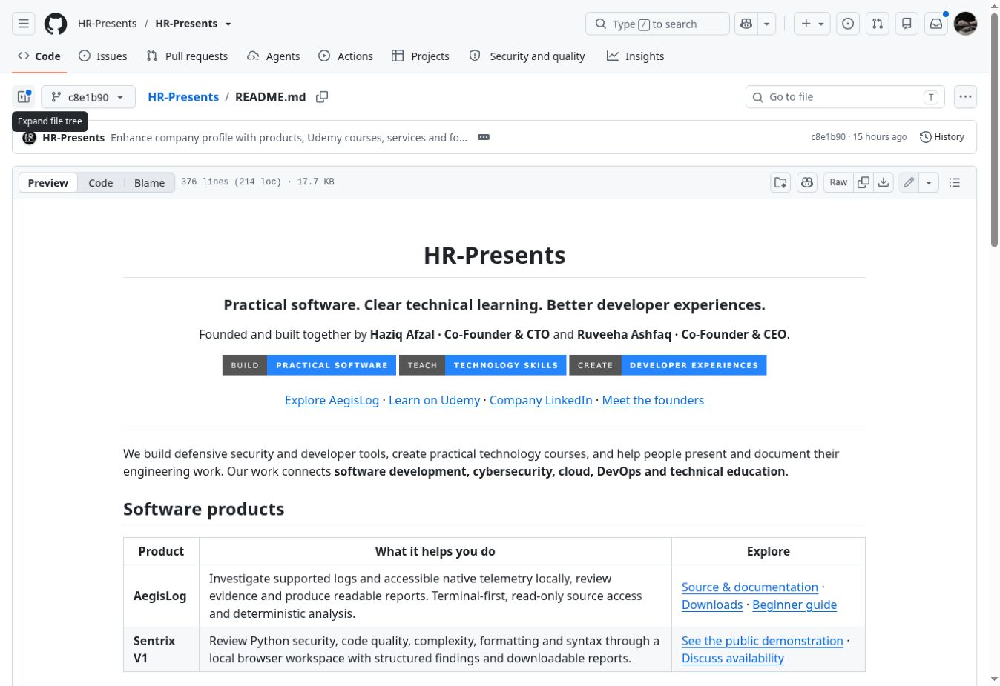
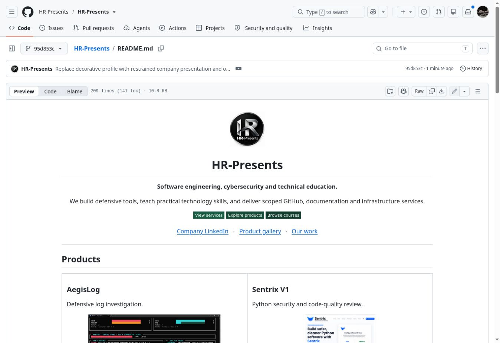

# HR-Presents profile redesign

[Company profile](README.md) · [Services](README.md#services)

An example of our GitHub presentation and documentation work using our own company profile. Haziq Afzal and Ruveeha Ashfaq collaborate under HR-Presents. This is a company-owned example, not a customer testimonial or a claim about sales, hiring or engagement outcomes.

## Before and after

Genuine GitHub screenshots, captured on 29 October 2026. Both use GitHub’s file preview with the file tree collapsed. The surrounding interface and revision labels remain visible.

| Earlier presentation | Revised presentation |
| --- | --- |
|  |  |
| [Earlier revision](https://github.com/HR-Presents/HR-Presents/blob/c8e1b9044bb1aa3e36c54650ef41c11bfa6e7a07/README.md) · [Full-size screenshot](assets/case-study/profile-before.jpg) | [Revised content](https://github.com/HR-Presents/HR-Presents/blob/95d853cd256c3b4ee63cb61e36dd4f4873314d18/README.md) · [Full-size screenshot](assets/case-study/profile-after.jpg) |

These screenshots show presentation and navigation changes. They have not been retouched and are not measured conversion results.

## The work

- Used the original company logo, a muted emerald accent palette and standard text headings.
- Organized products around original media, concise descriptions and primary actions.
- Added direct links to matching services and described the scope and handover process.
- Presented both courses with their original Udemy covers and enrollment-page links.
- Kept technical detail, source context and product limitations in linked documentation.

[Original product and course media](assets/media/SOURCES.md) · [Product gallery](product-gallery.md) · [README history](https://github.com/HR-Presents/HR-Presents/commits/main/README.md)

## Scope and verification

Checks cover repository files, image availability, navigation, structure and selected external destinations. The revised layout was inspected in GitHub’s desktop renderer. A genuine 390 px browser viewport test remains unverified.

The six linked Fiverr service pages were checked successfully on 29 October 2026. Third-party destinations can change.

For similar work, agreed deliverables may include editable Markdown, selected graphics, project navigation, installation or usage sections and handover notes. Scope, fixed price, package limits and timing are confirmed before ordering.

## Contact

[Haziq’s GitHub service](https://www.fiverr.com/haziq_afzal/enhance-your-github-profile-and-repository-readme) · [Ruveeha’s GitHub service](https://www.fiverr.com/ruveehaashfaq/redesign-your-github-profile-and-repository-readme) · [Company LinkedIn](https://www.linkedin.com/company/hr-presents/)
